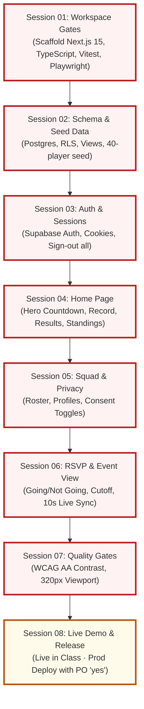

# PINT FC — Master Session Plan

> **Document**: `PLAN.md`  
> **Status**: Ready for Execution (Pending PO Approval)

---

## 1. Dependency Graph & Critical Path

**Critical Path**:
`Session 01` → `Session 02` → `Session 03` → `Session 04` → `Session 05` → `Session 06` → `Session 07` → `Session 08`.  
Every session is an essential prerequisite building block for subsequent features.

---

## 2. Session Execution Run Order

| # | Session File | Estimated Duration | Primary Focus |
| :--- | :--- | :--- | :--- |
| **01** | [plans/session-01-workspace-gates.md](file:///Users/hakandag/Desktop/Cydeo-Demo/plans/session-01-workspace-gates.md) | 25 min | Workspace scaffolding, tooling, and establishing all 5 verification gates. |
| **02** | [plans/session-02-schema-seed-data.md](file:///Users/hakandag/Desktop/Cydeo-Demo/plans/session-02-schema-seed-data.md) | 30 min | Postgres migrations, RLS policies, views, and 40-player fake seed dataset. |
| **03** | [plans/session-03-auth-sessions.md](file:///Users/hakandag/Desktop/Cydeo-Demo/plans/session-03-auth-sessions.md) | 25 min | Cookie-based player auth, persistent sessions, and multi-device sign-out. |
| **04** | [plans/session-04-home-page.md](file:///Users/hakandag/Desktop/Cydeo-Demo/plans/session-04-home-page.md) | 30 min | Home hero countdown, cutoff badge, season record, and mini standings. |
| **05** | [plans/session-05-squad-profiles-privacy.md](file:///Users/hakandag/Desktop/Cydeo-Demo/plans/session-05-squad-profiles-privacy.md) | 25 min | Squad roster, player profiles, 404 handling, and privacy consent toggles. |
| **06** | [plans/session-06-rsvp-cutoff-event-view.md](file:///Users/hakandag/Desktop/Cydeo-Demo/plans/session-06-rsvp-cutoff-event-view.md) | 30 min | RSVP actions, cutoff rejection, projector view, and 10s polling live sync. |
| **07** | [plans/session-07-quality-gates-look-b.md](file:///Users/hakandag/Desktop/Cydeo-Demo/plans/session-07-quality-gates-look-b.md) | 20 min | Look B polish, Axe WCAG AA contrast audit, and 320px viewport gate. |
| **08** | [plans/session-08-live-demo-release.md](file:///Users/hakandag/Desktop/Cydeo-Demo/plans/session-08-live-demo-release.md) | 20 min | **Live in class**: Cutoff demo, final regression, and PO production deploy. |

---

## 3. Check Ownership Matrix (All 38 Checks + 2 Gates)

Every in-scope check has **strictly one owner session**.

| Check ID | Area | Short Description | Owning Session | Plan File |
| :--- | :--- | :--- | :--- | :--- |
| **`AC-1.1.1`** | Auth | Player sign-in with valid credentials | **Session 03** | [session-03-auth-sessions.md](file:///Users/hakandag/Desktop/Cydeo-Demo/plans/session-03-auth-sessions.md) |
| **`AC-1.1.3`** | Auth | Sign-in error with invalid credentials | **Session 03** | [session-03-auth-sessions.md](file:///Users/hakandag/Desktop/Cydeo-Demo/plans/session-03-auth-sessions.md) |
| **`AC-1.1.4`** | Auth | Single-device player sign-out | **Session 03** | [session-03-auth-sessions.md](file:///Users/hakandag/Desktop/Cydeo-Demo/plans/session-03-auth-sessions.md) |
| **`AC-1.6.1`** | Sessions | Session persistence on refresh/nav | **Session 03** | [session-03-auth-sessions.md](file:///Users/hakandag/Desktop/Cydeo-Demo/plans/session-03-auth-sessions.md) |
| **`AC-1.6.2`** | Sessions | Sign out of all devices globally | **Session 03** | [session-03-auth-sessions.md](file:///Users/hakandag/Desktop/Cydeo-Demo/plans/session-03-auth-sessions.md) |
| **`AC-1.6.3`** | Sessions | Protected route / action redirect | **Session 03** | [session-03-auth-sessions.md](file:///Users/hakandag/Desktop/Cydeo-Demo/plans/session-03-auth-sessions.md) |
| **`AC-1.6.4`** | Sessions | Expired session handling with 401 | **Session 03** | [session-03-auth-sessions.md](file:///Users/hakandag/Desktop/Cydeo-Demo/plans/session-03-auth-sessions.md) |
| **`AC-2.1.1`** | Home | Next match fixture display | **Session 04** | [session-04-home-page.md](file:///Users/hakandag/Desktop/Cydeo-Demo/plans/session-04-home-page.md) |
| **`AC-2.1.2`** | Home | Next match live countdown | **Session 04** | [session-04-home-page.md](file:///Users/hakandag/Desktop/Cydeo-Demo/plans/session-04-home-page.md) |
| **`AC-2.1.3`** | Home | RSVP cutoff status indicator | **Session 04** | [session-04-home-page.md](file:///Users/hakandag/Desktop/Cydeo-Demo/plans/session-04-home-page.md) |
| **`AC-2.1.4`** | Home | Cancelled match representation | **Session 04** | [session-04-home-page.md](file:///Users/hakandag/Desktop/Cydeo-Demo/plans/session-04-home-page.md) |
| **`AC-2.1.5`** | Home | Competition type tag (league/friendly) | **Session 04** | [session-04-home-page.md](file:///Users/hakandag/Desktop/Cydeo-Demo/plans/session-04-home-page.md) |
| **`AC-2.1.6`** | Home | Empty state for no upcoming matches | **Session 04** | [session-04-home-page.md](file:///Users/hakandag/Desktop/Cydeo-Demo/plans/session-04-home-page.md) |
| **`AC-2.2.1`** | Home | Season record Win-Draw-Loss | **Session 04** | [session-04-home-page.md](file:///Users/hakandag/Desktop/Cydeo-Demo/plans/session-04-home-page.md) |
| **`AC-2.2.2`** | Home | Goals For, Against, and Difference | **Session 04** | [session-04-home-page.md](file:///Users/hakandag/Desktop/Cydeo-Demo/plans/session-04-home-page.md) |
| **`AC-2.2.3`** | Home | Unpublished matches excluded from record | **Session 02** | [session-02-schema-seed-data.md](file:///Users/hakandag/Desktop/Cydeo-Demo/plans/session-02-schema-seed-data.md) |
| **`AC-2.2.4`** | Home | Friendlies excluded from league record | **Session 02** | [session-02-schema-seed-data.md](file:///Users/hakandag/Desktop/Cydeo-Demo/plans/session-02-schema-seed-data.md) |
| **`AC-2.3.1`** | Home | Latest published results feed | **Session 04** | [session-04-home-page.md](file:///Users/hakandag/Desktop/Cydeo-Demo/plans/session-04-home-page.md) |
| **`AC-2.3.2`** | Home | Draft results concealed from results feed | **Session 02** | [session-02-schema-seed-data.md](file:///Users/hakandag/Desktop/Cydeo-Demo/plans/session-02-schema-seed-data.md) |
| **`AC-2.4.1`** | Home | Mini league standings table | **Session 04** | [session-04-home-page.md](file:///Users/hakandag/Desktop/Cydeo-Demo/plans/session-04-home-page.md) |
| **`AC-2.4.2`** | Home | PINT FC row highlighting in standings | **Session 04** | [session-04-home-page.md](file:///Users/hakandag/Desktop/Cydeo-Demo/plans/session-04-home-page.md) |
| **`AC-2.4.3`** | Home | Seeded snapshot table resiliency | **Session 02** | [session-02-schema-seed-data.md](file:///Users/hakandag/Desktop/Cydeo-Demo/plans/session-02-schema-seed-data.md) |
| **`AC-4.1.1`** | Squad | Positional squad roster grouping | **Session 05** | [session-05-squad-profiles-privacy.md](file:///Users/hakandag/Desktop/Cydeo-Demo/plans/session-05-squad-profiles-privacy.md) |
| **`AC-4.1.2`** | Squad | Archived players completely excluded | **Session 02** | [session-02-schema-seed-data.md](file:///Users/hakandag/Desktop/Cydeo-Demo/plans/session-02-schema-seed-data.md) |
| **`AC-4.1.3`** | Squad | Squad cards display number, name, position | **Session 05** | [session-05-squad-profiles-privacy.md](file:///Users/hakandag/Desktop/Cydeo-Demo/plans/session-05-squad-profiles-privacy.md) |
| **`AC-4.2.1`** | Profiles | Player profile loads permitted info | **Session 05** | [session-05-squad-profiles-privacy.md](file:///Users/hakandag/Desktop/Cydeo-Demo/plans/session-05-squad-profiles-privacy.md) |
| **`AC-4.2.2`** | Profiles | Archived/invalid player returns 404 | **Session 05** | [session-05-squad-profiles-privacy.md](file:///Users/hakandag/Desktop/Cydeo-Demo/plans/session-05-squad-profiles-privacy.md) |
| **`AC-4.3.1`** | Privacy | Invariant 1: Zero public PII leakage | **Session 02** | [session-02-schema-seed-data.md](file:///Users/hakandag/Desktop/Cydeo-Demo/plans/session-02-schema-seed-data.md) |
| **`AC-4.3.2`** | Privacy | Consent toggles suppress photo/nationality | **Session 05** | [session-05-squad-profiles-privacy.md](file:///Users/hakandag/Desktop/Cydeo-Demo/plans/session-05-squad-profiles-privacy.md) |
| **`AC-4.3.3`** | Privacy | Minor without guardian consent protected | **Session 02** | [session-02-schema-seed-data.md](file:///Users/hakandag/Desktop/Cydeo-Demo/plans/session-02-schema-seed-data.md) |
| **`AC-4.3.4`** | Privacy | Player updates privacy preferences live | **Session 05** | [session-05-squad-profiles-privacy.md](file:///Users/hakandag/Desktop/Cydeo-Demo/plans/session-05-squad-profiles-privacy.md) |
| **`AC-3.3.1`** | RSVP | Player submits Going / Maybe / Not Going | **Session 06** | [session-06-rsvp-cutoff-event-view.md](file:///Users/hakandag/Desktop/Cydeo-Demo/plans/session-06-rsvp-cutoff-event-view.md) |
| **`AC-3.3.2`** | RSVP | Player updates RSVP choice before cutoff | **Session 06** | [session-06-rsvp-cutoff-event-view.md](file:///Users/hakandag/Desktop/Cydeo-Demo/plans/session-06-rsvp-cutoff-event-view.md) |
| **`AC-3.3.4`** | RSVP | RSVP mutation after cutoff rejected (403) | **Session 06** | [session-06-rsvp-cutoff-event-view.md](file:///Users/hakandag/Desktop/Cydeo-Demo/plans/session-06-rsvp-cutoff-event-view.md) |
| **`AC-3.3.5`** | RSVP | Player views teammates attendance list | **Session 06** | [session-06-rsvp-cutoff-event-view.md](file:///Users/hakandag/Desktop/Cydeo-Demo/plans/session-06-rsvp-cutoff-event-view.md) |
| **`AC-3.3.6`** | RSVP | Teammate private reasons hidden | **Session 06** | [session-06-rsvp-cutoff-event-view.md](file:///Users/hakandag/Desktop/Cydeo-Demo/plans/session-06-rsvp-cutoff-event-view.md) |
| **`AC-3.4.1`** | Event Page | Projector view renders counts & roster | **Session 06** | [session-06-rsvp-cutoff-event-view.md](file:///Users/hakandag/Desktop/Cydeo-Demo/plans/session-06-rsvp-cutoff-event-view.md) |
| **`AC-3.4.3`** | Event Page | Live counts update within 15 seconds | **Session 06** | [session-06-rsvp-cutoff-event-view.md](file:///Users/hakandag/Desktop/Cydeo-Demo/plans/session-06-rsvp-cutoff-event-view.md) |
| **`AC-5.2`** | Quality Gate | WCAG AA color contrast audit across all pages | **Session 07** | [session-07-quality-gates-look-b.md](file:///Users/hakandag/Desktop/Cydeo-Demo/plans/session-07-quality-gates-look-b.md) |
| **`AC-5.4`** | Quality Gate | Mobile 320px viewport zero horizontal scroll | **Session 07** | [session-07-quality-gates-look-b.md](file:///Users/hakandag/Desktop/Cydeo-Demo/plans/session-07-quality-gates-look-b.md) |

---

## 4. Production Release Rule

As specified in `CLAUDE.md`:  
> **Production deploy is the last step of Session 08 and requires the product owner's explicit "yes".**  
No code or migrations are deployed to production without direct PO confirmation.
