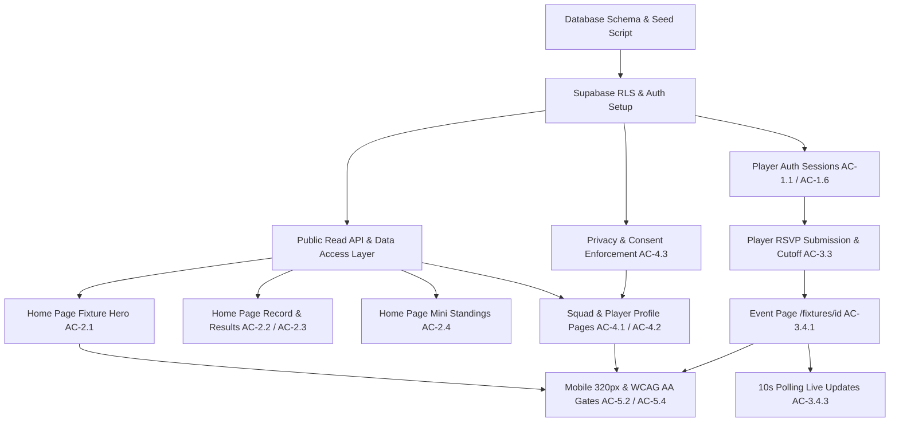

# PINT FC MVP — Requirements Specification

> **Document**: `docs/REQUIREMENTS.md`  
> **Source**: `docs/requirements/PINTFC-MVP-Requirements.pdf` (commit `47b5ac1`)  
> **Status**: Derived from PDF specification; Pending PO Approval

---

## 1. User Roles & Capabilities

| Role | Description | Capabilities | Restrictions |
| :--- | :--- | :--- | :--- |
| **Visitor (Fan)** | Public, unauthenticated user | - View Home page: next match countdown, season record, latest published results, mini league table snapshot - View Squad roster grouped by position - View individual player profiles (strictly consented fields only) - View open event page (`/fixtures/[id]`) | - Cannot RSVP - Cannot view player PII (email, phone, DOB) - Cannot view unconsented player attributes (photo, nationality, stats) - Cannot view unconsented under-18 players - Cannot view unpublished match results or archived players |
| **Player** | Authenticated club member (fake login account) | - All Visitor capabilities - Sign in and sign out (including "Sign out of all devices") - Manage own privacy consent settings (photo, nationality, stats) - Submit/update RSVP (Going, Maybe, Not going) with optional private note before cutoff - View teammates' attendance responses on upcoming matches | - Cannot view teammates' private RSVP notes/reasons - Cannot submit or edit RSVP after cutoff time - Cannot edit another player's profile, privacy, or RSVP - Cannot access admin management features |
| **Admin** | System / Club administrator | - Seed and manage initial data via automated seed scripts | - **Out of scope for MVP UI**: No admin console, no manual match editor, no user invite UI, no MFA setup screens in MVP |

---

## 2. Scope Boundaries

### In Scope
- **Sign-in & Sessions (7 checks)**: Fake player authentication, persistent sessions, sign out, sign out of all devices, session expiration & protected route redirection.
- **Home Page (15 checks)**: Next match countdown, kickoff & venue display, RSVP status, friendly vs league distinction, season record (W-D-L, GF, GA, GD), published results list, mini standings snapshot with PINT FC highlighted, draft result exclusion.
- **Squad & Profiles (9 checks)**: Positional roster (Goalkeepers, Defenders, Midfielders, Forwards), player profiles, archived player exclusion, strict privacy invariant 1 (no PII leakage), consent toggles (photo, nationality, stats), U-18 guardian consent protection, self-service privacy updates.
- **Going / Not Going (7 checks)**: RSVP submission (Going / Maybe / Not going), RSVP modifications before cutoff, strict cutoff enforcement ("RSVP closed"), attendance list view for teammates, teammate reason confidentiality, public event page (`/fixtures/[id]`), live count polling within 15 seconds.
- **Design & Quality Gates**: Look B ("Sport" light theme), WCAG AA color contrast (AC-5.2), mobile responsiveness with no horizontal scroll at 320 px (AC-5.4).

### Out of Scope (Explicitly Deferred)
- Admin console (`FR-9.x`), member invitations (`FR-1.2`), password reset (`FR-1.3`), admin MFA (`FR-1.4`, `FR-1.8`, `AC-1.1.2`).
- Social logins: Google / Apple sign-in (`FR-1.5`).
- Account lockout & rate limiting (`FR-1.7` accepted risk for fake data MVP).
- Full schedule & calendar feeds (`FR-3.1`, `FR-3.5`), full event details (`FR-3.2`), waitlists (`FR-3.6`).
- Post-cutoff changes: Moving kickoff times (`AC-3.3.3`), admin attendance overrides (`AC-3.4.2`).
- Full leaderboards (`FR-5.1`), full table page, live standings sync, manual standings (`FR-5.2`–`5.4`).
- Man of the Match (`4.6`), club store (`4.7`), news & notifications (`4.8`), newsletter (`AC-10.1.x`), account deletion requests (`AC-4.3.5`).
- Secondary dark theme and theme toggle (`AC-5.1`), reduced motion settings (`AC-5.3`), Instagram feeds (`FR-10.2`), featured story blocks (`FR-2.5`), PWA installability.

---

## 3. The 38 Acceptance Checks (Given / When / Then)

All 38 checks are derived from `PINTFC-MVP-Requirements.pdf` and mapped to their canonical IDs.

### 3.1 Sign-In & Sessions (7 Checks)

#### `AC-1.1.1` Player Sign-In with Valid Credentials `(derived)`
- **Given**: A seeded fake player account with valid email and password.
- **When**: The user enters their valid credentials on the sign-in form and submits.
- **Then**: An authenticated session is established, a secure session token is set, and the user is redirected to the dashboard/home page showing authenticated state.

#### `AC-1.1.3` Sign-In Failure with Invalid Credentials `(derived)`
- **Given**: An unauthenticated user.
- **When**: The user attempts to sign in with incorrect password or unseeded email.
- **Then**: Authentication fails, a descriptive error message is shown, no session cookie is created, and the form remains available.

#### `AC-1.1.4` Single-Device Sign-Out `(derived)`
- **Given**: A player signed in on the current browser.
- **When**: The player clicks "Sign Out".
- **Then**: The current device session is terminated, session cookies are cleared, and the UI immediately reflects unauthenticated visitor state.

#### `AC-1.6.1` Session Persistence `(derived)`
- **Given**: A player with an active authenticated session.
- **When**: The player refreshes the page or navigates between application routes.
- **Then**: The authenticated state and player profile context persist without requiring re-login.

#### `AC-1.6.2` Sign Out of All Devices `(derived)`
- **Given**: A player signed in across multiple devices/browsers.
- **When**: The player selects "Sign out of all devices" from their profile/account settings.
- **Then**: Supabase revokes all active refresh tokens for this user, invalidating sessions on all other devices upon their next request.

#### `AC-1.6.3` Protected Route & Action Redirection `(derived)`
- **Given**: An unauthenticated visitor.
- **When**: The visitor attempts to navigate to a protected page (e.g. privacy settings) or submit an RSVP action.
- **Then**: The request is intercepted and redirected to `/login` with an informative redirect notice, preventing unauthorized execution.

#### `AC-1.6.4` Graceful Expired Session Handling `(derived)`
- **Given**: A player session that has expired or been revoked.
- **When**: The player attempts an authenticated interaction (e.g. submitting an RSVP).
- **Then**: The application handles the 401 response gracefully without throwing an unhandled exception, alerts the user, and prompts re-authentication.

---

### 3.2 Home Page (15 Checks)

#### `AC-2.1.1` Next Match Fixture Display `(derived)`
- **Given**: A scheduled upcoming match in the database.
- **When**: A visitor navigates to the home page.
- **Then**: The hero section displays the opponent name, opponent crest placeholder, venue name, and scheduled kickoff date and time.

#### `AC-2.1.2` Next Match Live Countdown `(derived)`
- **Given**: An upcoming match with a future kickoff timestamp.
- **When**: The home page is loaded and viewed.
- **Then**: An active countdown timer dynamically shows remaining days, hours, and minutes until kickoff.

#### `AC-2.1.3` RSVP Cutoff Status Indicator `(derived)`
- **Given**: An upcoming match with an RSVP cutoff timestamp.
- **When**: The home page hero card is viewed.
- **Then**: The card clearly indicates whether RSVP is currently "Open" (with time remaining until cutoff) or "Closed".

#### `AC-2.1.4` Cancelled Match Representation `(derived)`
- **Given**: An upcoming match marked as `cancelled: true`.
- **When**: Home page is rendered.
- **Then**: The fixture card prominently displays a "MATCH CANCELLED" badge or advances hero focus to the next scheduled active fixture.

#### `AC-2.1.5` Competition Type Distinction `(derived)`
- **Given**: An upcoming fixture categorized as a friendly vs league match.
- **When**: The match card is displayed on the home page.
- **Then**: The competition tag clearly distinguishes between "League Match" and "Friendly".

#### `AC-2.1.6` No Upcoming Matches Empty State `(derived)`
- **Given**: The database contains no future scheduled fixtures.
- **When**: A visitor views the home page hero section.
- **Then**: A graceful fallback card is displayed stating "No upcoming fixtures scheduled" with off-season contact details.

#### `AC-2.2.1` Season Record Win-Draw-Loss `(derived)`
- **Given**: Published league match results in the seed dataset.
- **When**: The visitor views the Season Record widget.
- **Then**: Total matches played, wins, draws, and losses (W-D-L) accurately aggregate published results.

#### `AC-2.2.2` Goals For, Goals Against, and Goal Difference `(derived)`
- **Given**: Published league match scores.
- **When**: The Season Record is computed and displayed.
- **Then**: Goals For (GF), Goals Against (GA), and Goal Difference (GD = GF - GA) match the published scores.

#### `AC-2.2.3` Exclusion of Unpublished Results from Record `(derived)`
- **Given**: A match result marked as draft or `published: false`.
- **When**: Season record aggregates are calculated.
- **Then**: The unpublished match score is strictly excluded from W-D-L, GF, GA, and GD totals.

#### `AC-2.2.4` Exclusion of Friendlies from League Record `(derived)`
- **Given**: Completed friendly match results in the database.
- **When**: The official league season record is displayed.
- **Then**: Friendly match statistics do not contaminate official league standings and records.

#### `AC-2.3.1` Latest Results Feed `(derived)`
- **Given**: Completed matches with published scores.
- **When**: A visitor views the "Latest Results" section on the home page.
- **Then**: A chronological list of recent results shows the opponent, final score, match date, and outcome badge (W/D/L).

#### `AC-2.3.2` Draft Result Concealment `(derived)`
- **Given**: A match result saved with `published: false`.
- **When**: Any visitor or player views the Latest Results feed.
- **Then**: The draft result is completely absent from the results feed.

#### `AC-2.4.1` Mini Standings Table Display `(derived)`
- **Given**: A seeded snapshot of the league table.
- **When**: A visitor views the home page standings widget.
- **Then**: The mini table displays team rank, team name, played (P), and points (PTS) for top teams.

#### `AC-2.4.2` PINT FC Row Highlighting `(derived)`
- **Given**: The mini league table rendered on screen.
- **When**: The table rows are displayed.
- **Then**: PINT FC's row is visually emphasized with distinct styling (badge/border/background accent).

#### `AC-2.4.3` Seeded Snapshot Resiliency `(derived)`
- **Given**: MVP scope excluding live external standings sync.
- **When**: Standings component renders.
- **Then**: Table renders reliably from local seeded snapshot without external network dependencies.

---

### 3.3 Squad and Player Profiles (9 Checks)

#### `AC-4.1.1` Positional Squad Roster `(derived)`
- **Given**: 40 active seeded players with assigned positions.
- **When**: A visitor navigates to `/squad`.
- **Then**: Players are grouped into four clear positional categories: Goalkeepers, Defenders, Midfielders, and Forwards.

#### `AC-4.1.2` Absolute Exclusion of Archived Players `(derived)`
- **Given**: At least one player flagged with `archived: true` (or inactive) in the database.
- **When**: The squad list or player directory is queried or displayed.
- **Then**: The archived player never appears in the list, search, or count.

#### `AC-4.1.3` Squad Card Display Rules `(derived)`
- **Given**: Active players in the squad list.
- **When**: Squad cards are rendered.
- **Then**: Each card displays player full name (or display name), squad number, and position, omitting restricted fields.

#### `AC-4.2.1` Individual Player Profile View `(derived)`
- **Given**: An active player in the database.
- **When**: A visitor visits `/squad/[id]`.
- **Then**: The profile renders the player's permitted biographical and sporting information.

#### `AC-4.2.2` Archived or Invalid Profile 404 `(derived)`
- **Given**: A player ID that does not exist or belongs to an archived player.
- **When**: A user attempts to navigate directly to `/squad/[id]`.
- **Then**: The server returns a 404 Not Found response and renders a user-friendly error page.

#### `AC-4.3.1` Invariant 1: Zero Public PII Leakage `(derived)`
- **Given**: Any public request to `/squad`, `/squad/[id]`, `/api/players`, or `/fixtures/[id]`.
- **When**: The HTTP response payload is inspected.
- **Then**: The response MUST NOT contain email, phone number, date of birth, guardian contact, or private RSVP notes under any condition.

#### `AC-4.3.2` Granular Consent Enforcement `(derived)`
- **Given**: A player with specific consent flags toggled off (e.g. `consent_photo: false`, `consent_nationality: false`, `consent_stats: false`).
- **When**: That player's public profile is viewed.
- **Then**: The photo falls back to a neutral avatar, nationality/flag is hidden, and personal stats are omitted.

#### `AC-4.3.3` Under-18 Minor Guardian Protection `(derived)`
- **Given**: Two players under 18 years old in the database:
  - Player A: Minor without verified guardian consent (`guardian_consent: false`).
  - Player B: Minor with guardian consent and opt-in (`guardian_consent: true`, `opt_in: true`).
- **When**: Public squad and profile views are requested.
- **Then**: Player A's profile is suppressed or restricted to anonymous placeholder, while Player B displays only strictly consented fields.

#### `AC-4.3.4` Self-Service Privacy Preference Update `(derived)`
- **Given**: An authenticated player on their profile settings page (`/profile/privacy`).
- **When**: The player modifies their consent toggles (photo, nationality, stats) and saves.
- **Then**: The database updates immediately, and subsequent public queries reflect the updated privacy settings.

---

### 3.4 Going / Not Going (7 Checks)

#### `AC-3.3.1` Player RSVP Submission `(derived)`
- **Given**: An authenticated player viewing the next match before the cutoff time.
- **When**: The player selects an RSVP status (`Going`, `Maybe`, or `Not going`) and optionally inputs a private reason.
- **Then**: The response is recorded in the database and the UI reflects their selected status.

#### `AC-3.3.2` RSVP Update Before Cutoff `(derived)`
- **Given**: A player who has already submitted an RSVP.
- **When**: The player alters their choice (e.g. from `Maybe` to `Going`) prior to the cutoff timestamp.
- **Then**: The existing record is updated, and the attendance tally adjusts accordingly.

#### `AC-3.3.4` Strict Cutoff Rejection `(derived)`
- **Given**: An upcoming fixture whose RSVP cutoff time is in the past (`now() > rsvp_cutoff`).
- **When**: A player attempts to submit or alter an RSVP via UI or direct API request.
- **Then**: The operation is rejected with an HTTP 403/409 error, the database refuses mutation via RLS, and the UI displays "RSVP closed".

#### `AC-3.3.5` Teammates Attendance List `(derived)`
- **Given**: An authenticated player viewing the upcoming fixture.
- **When**: The player views the attendance section.
- **Then**: The player can see which teammates have responded `Going`, `Maybe`, or `Not going`.

#### `AC-3.3.6` Teammate Reason Confidentiality `(derived)`
- **Given**: A player who submitted a private reason/note with their RSVP (e.g. "Injured knee" or "Working late").
- **When**: Other authenticated teammates view the fixture attendance list.
- **Then**: Teammates can see the status (`Not going`) but the reason is completely hidden from everyone except the player themselves.

#### `AC-3.4.1` Event Page (`/fixtures/[id]`) Projector View `(derived)`
- **Given**: A fixture event page at `/fixtures/[id]`.
- **When**: Opened on a desktop or classroom projector.
- **Then**: The page presents high-visibility total counts (Going, Maybe, Not going) and the categorized roster of attendees.

#### `AC-3.4.3` Live Count Polling Within 15 Seconds `(derived)`
- **Given**: An open event page on Client A.
- **When**: Client B submits a new RSVP or modifies their response.
- **Then**: Client A reflects the updated attendance count within 15 seconds (using 10-second active polling).

---

### 3.5 Design & Accessibility Gates (2 Checks)

#### `AC-5.2` WCAG AA Color Contrast Gate `(derived)`
- **Given**: All pages in Look B ("Sport" light theme).
- **When**: Automated accessibility contrast audit is executed.
- **Then**: All text against its background meets or exceeds WCAG 2.1 AA contrast thresholds (minimum 4.5:1 for body copy, 3:1 for large headers and interactive components).

#### `AC-5.4` Mobile Viewport (320px) Gate `(derived)`
- **Given**: A mobile browser viewport width of 320px.
- **When**: Any MVP page (Home, Squad, Profile, Fixture, Login) is rendered.
- **Then**: No horizontal scrolling occurs (`overflow-x` is clean) and all interactive elements remain fully usable.

---

## 4. Cross-Cutting Rules

1. **Privacy & Invariant 1**:
   - Privacy is enforced at the **Postgres Database layer (RLS / Views)** as well as the API layer.
   - Postgres Row Level Security ensures the `anon` role cannot select columns: `email`, `phone`, `date_of_birth`, `guardian_name`, `guardian_email`, `rsvp_note`.
   - Even authenticated players cannot select other players' `rsvp_note` or contact details.
2. **RSVP Cutoff Enforcement**:
   - Stored in UTC (`TIMESTAMPTZ`).
   - Cutoff logic is enforced simultaneously in three places:
     1. Client UI: Disabled buttons, "RSVP closed" badge.
     2. Server API Route: Validation returning `403 Forbidden` if `now() > rsvp_cutoff`.
     3. Database RLS / Trigger: `CHECK` constraint or RLS policy `WITH CHECK (now() < (SELECT rsvp_cutoff FROM fixtures WHERE id = fixture_id))`.
3. **15-Second Count Synchronization**:
   - Implemented via a lightweight polling hook (interval: 10s).
   - Pauses when tab is hidden (`document.visibilityState === 'hidden'`) to respect Vercel/Supabase rate limits and save battery/bandwidth.
4. **Seed Dataset Integrity (Fake Data Only)**:
   - Exactly 40 active players (balanced across GK, DEF, MID, FWD).
   - Exactly 1 archived player (must never leak into UI or public API).
   - Exactly 2 minors (<18): one with guardian consent, one without.
   - Mix of photo, nationality, and stats consents.
   - Historical matches: published league matches, 1 friendly, 1 unpublished draft result.
   - Upcoming matches: next match (class demo), 1 cancelled match, weekly training sessions.
   - 1 static league standings snapshot.

---

## 5. Dependency Architecture

---

## 6. Risks, Vulnerabilities & Gaps Analysis

1. **Time Zones & Daylight Saving Time (DST)**:
   - *Risk*: Hardcoding UTC offsets causes match kickoff or cutoff times to shift when clocks change.
   - *Mitigation*: Store all match timestamps as `TIMESTAMPTZ` in UTC and format them using the venue's explicit IANA timezone (`Europe/London`).
2. **Database API Direct Access (Bypassing App UI)**:
   - *Risk*: A student or malicious player obtains their Supabase JWT and calls PostgREST directly (e.g. `PATCH /rest/v1/rsvps` after the cutoff, or selects `rsvp_note` of other teammates).
   - *Mitigation*: RLS policies in Postgres MUST enforce:
     - `auth.uid() = player_id` for RSVP inserts/updates.
     - Cutoff check in RLS `WITH CHECK` expression.
     - Column-level privilege restriction or RLS policy preventing retrieval of `rsvp_note` for records where `player_id != auth.uid()`.
3. **Privacy Leakage via Direct Queries**:
   - *Risk*: Public API returns full player row containing `email`, `phone`, `date_of_birth`.
   - *Mitigation*: Create a dedicated Postgres view `public_players` that explicitly selects only safe public columns, or use Supabase RLS column security. Public API only queries this view.
4. **Vercel Preview Cookies**:
   - *Risk*: Vercel creates unique subdomains for every preview deployment. Cookies scoped to a specific domain might break across preview URLs.
   - *Mitigation*: Use `@supabase/ssr` with standard cookie options (SameSite=Lax, Secure, Path=/), omitting hardcoded domain attributes.
5. **Supabase & Vercel Free Plan Quotas**:
   - *Risk*: Frequent polling by multiple students exhausted Supabase connection pools or Vercel serverless function invocations.
   - *Mitigation*: Polling set to 10 seconds, only active when the tab is visible. Client caches standings and static profile data.

---

## 7. Product Owner Questions & Proposed Defaults

| # | Question for Product Owner | Proposed Default | Impact |
| :--- | :--- | :--- | :--- |
| **Q1** | What is the scheduled kickoff and RSVP cutoff date/time for the live class demo match? | Kickoff: **Nov 7, 2026 at 15:00 UTC**. Cutoff: Configurable or set to **15 minutes into the class demo** so students witness "RSVP closed" live. | Drives seed script parameters and live test. |
| **Q2** | How should test credentials for the 40 fake players be managed during review/demo? | Seed fixed credentials: `player<1..40>@pintfc.test` with password `PintFC2026!` and provide a dev login switcher on preview builds. | Enables quick testing without manual sign-ups. |
| **Q3** | What exact criteria define a minor (<18) relative to match day? | Player `date_of_birth > (current_date - INTERVAL '18 years')`. | Governs automated privacy mask logic. |
| **Q4** | What venue and timezone should be used as standard? | Venue: "Pint FC Ground", Timezone: `Europe/London`. | Ensures uniform datetime rendering. |
