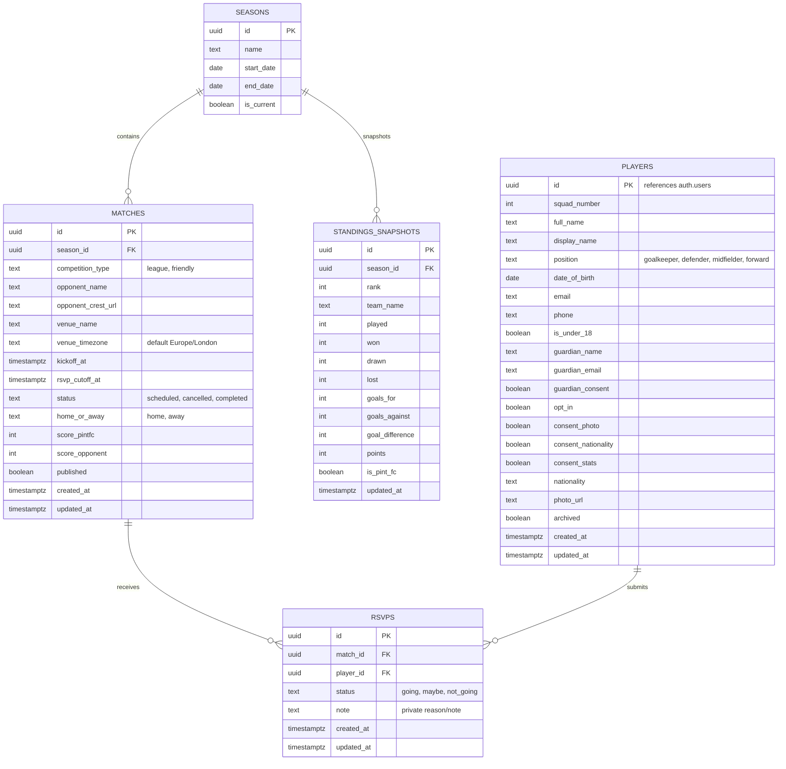

# PINT FC — Data Model & Access Matrix

> **Document**: `docs/design/data.md`  
> **Status**: Design Proposal (Pending PO Approval)

---

## 1. Entity Relationship Diagram (ERD)



---

## 2. Table Specifications

### 2.1 `players`
Stores player directory, contact info, minor/guardian consent, and public display preferences.
- **`id`** (`UUID`, Primary Key): Foreign key referencing Supabase `auth.users.id`.
- **`squad_number`** (`INTEGER`, NOT NULL): Unique squad shirt number (1–99).
- **`full_name`** (`TEXT`, NOT NULL): Full legal or registered name.
- **`display_name`** (`TEXT`, NOT NULL): Matchday display name shown on public roster.
- **`position`** (`TEXT`, NOT NULL): Validated via check constraint: `position IN ('goalkeeper', 'defender', 'midfielder', 'forward')`.
- **`date_of_birth`** (`DATE`, NOT NULL): Player DOB (strictly private).
- **`email`** (`TEXT`, NOT NULL): Player email (strictly private).
- **`phone`** (`TEXT`, NULLABLE): Contact phone number (strictly private).
- **`is_under_18`** (`BOOLEAN`, GENERATED ALWAYS AS (`date_of_birth > (CURRENT_DATE - INTERVAL '18 years')`) STORED): Automated flag.
- **`guardian_name`** (`TEXT`, NULLABLE): Required if `is_under_18` is true.
- **`guardian_email`** (`TEXT`, NULLABLE): Required if `is_under_18` is true.
- **`guardian_consent`** (`BOOLEAN`, NOT NULL DEFAULT false): Parental consent verification.
- **`opt_in`** (`BOOLEAN`, NOT NULL DEFAULT false): Additional consent for public display.
- **`consent_photo`** (`BOOLEAN`, NOT NULL DEFAULT true): Controls public photo display.
- **`consent_nationality`** (`BOOLEAN`, NOT NULL DEFAULT true): Controls nationality flag display.
- **`consent_stats`** (`BOOLEAN`, NOT NULL DEFAULT true): Controls personal performance stats display.
- **`nationality`** (`TEXT`, NULLABLE): Country ISO code or name.
- **`photo_url`** (`TEXT`, NULLABLE): URL to player photo asset.
- **`archived`** (`BOOLEAN`, NOT NULL DEFAULT false): If true, player is hidden from all squad listings and public profile views.
- **`created_at`** (`TIMESTAMPTZ`, DEFAULT `now()`).
- **`updated_at`** (`TIMESTAMPTZ`, DEFAULT `now()`).

### 2.2 `matches`
Stores fixtures, kickoffs, cutoff deadlines, results, and competition classification.
- **`id`** (`UUID`, Primary Key, DEFAULT `gen_random_uuid()`).
- **`season_id`** (`UUID`, References `seasons.id`, NOT NULL).
- **`competition_type`** (`TEXT`, NOT NULL): `competition_type IN ('league', 'friendly')`.
- **`opponent_name`** (`TEXT`, NOT NULL): Opponent club name.
- **`opponent_crest_url`** (`TEXT`, NULLABLE): Placeholder crest image path.
- **`venue_name`** (`TEXT`, NOT NULL): Match pitch/ground name.
- **`venue_timezone`** (`TEXT`, NOT NULL DEFAULT `'Europe/London'`).
- **`kickoff_at`** (`TIMESTAMPTZ`, NOT NULL): Exact kickoff in UTC.
- **`rsvp_cutoff_at`** (`TIMESTAMPTZ`, NOT NULL): RSVP lock deadline in UTC.
- **`status`** (`TEXT`, NOT NULL DEFAULT `'scheduled'`): `status IN ('scheduled', 'cancelled', 'completed')`.
- **`home_or_away`** (`TEXT`, NOT NULL): `home_or_away IN ('home', 'away')`.
- **`score_pintfc`** (`INTEGER`, NULLABLE): Null until match completed.
- **`score_opponent`** (`INTEGER`, NULLABLE): Null until match completed.
- **`published`** (`BOOLEAN`, NOT NULL DEFAULT false): If false, result is draft/hidden from public season record.
- **Constraints**:
  - `CHECK (rsvp_cutoff_at <= kickoff_at)`: Cutoff cannot occur after kickoff.
  - `CHECK (score_pintfc >= 0 AND score_opponent >= 0)`.

### 2.3 `rsvps`
Stores individual player match attendance commitments and private notes.
- **`id`** (`UUID`, Primary Key, DEFAULT `gen_random_uuid()`).
- **`match_id`** (`UUID`, References `matches.id` ON DELETE CASCADE, NOT NULL).
- **`player_id`** (`UUID`, References `players.id` ON DELETE CASCADE, NOT NULL).
- **`status`** (`TEXT`, NOT NULL): `status IN ('going', 'maybe', 'not_going')`.
- **`note`** (`TEXT`, NULLABLE): Private explanation (e.g. reason for absence; visible ONLY to author).
- **`created_at`** (`TIMESTAMPTZ`, DEFAULT `now()`).
- **`updated_at`** (`TIMESTAMPTZ`, DEFAULT `now()`).
- **Unique Constraint**: `UNIQUE (match_id, player_id)` — One RSVP per player per match.

### 2.4 `standings_snapshots`
Cached league table snapshot for the mini table component.
- **`id`** (`UUID`, Primary Key, DEFAULT `gen_random_uuid()`).
- **`season_id`** (`UUID`, References `seasons.id`, NOT NULL).
- **`rank`** (`INTEGER`, NOT NULL).
- **`team_name`** (`TEXT`, NOT NULL).
- **`played`** (`INTEGER`, NOT NULL DEFAULT 0).
- **`won`** (`INTEGER`, NOT NULL DEFAULT 0).
- **`drawn`** (`INTEGER`, NOT NULL DEFAULT 0).
- **`lost`** (`INTEGER`, NOT NULL DEFAULT 0).
- **`goals_for`** (`INTEGER`, NOT NULL DEFAULT 0).
- **`goals_against`** (`INTEGER`, NOT NULL DEFAULT 0).
- **`goal_difference`** (`INTEGER`, NOT NULL DEFAULT 0).
- **`points`** (`INTEGER`, NOT NULL DEFAULT 0).
- **`is_pint_fc`** (`BOOLEAN`, NOT NULL DEFAULT false).

---

## 3. Public Database Views (Enforcing Invariant 1)

To strictly enforce **AC-4.3.1 (Invariant 1: Zero public PII leakage)** at the database engine level, unauthenticated queries target PostgreSQL Views rather than raw tables:

### 3.1 `view_public_players`
```sql
CREATE OR REPLACE VIEW view_public_players AS
SELECT 
    p.id,
    p.squad_number,
    p.display_name,
    p.position,
    CASE WHEN p.consent_photo = true THEN p.photo_url ELSE NULL END AS photo_url,
    CASE WHEN p.consent_nationality = true THEN p.nationality ELSE NULL END AS nationality
FROM players p
WHERE p.archived = false
  AND (
      p.is_under_18 = false 
      OR (p.guardian_consent = true AND p.opt_in = true)
  );
```

### 3.2 `view_public_results`
```sql
CREATE OR REPLACE VIEW view_public_results AS
SELECT 
    m.id,
    m.competition_type,
    m.opponent_name,
    m.opponent_crest_url,
    m.venue_name,
    m.kickoff_at,
    m.home_or_away,
    m.score_pintfc,
    m.score_opponent,
    CASE 
        WHEN m.score_pintfc > m.score_opponent THEN 'W'
        WHEN m.score_pintfc = m.score_opponent THEN 'D'
        ELSE 'L'
    END AS outcome
FROM matches m
WHERE m.published = true 
  AND m.status = 'completed'
ORDER BY m.kickoff_at DESC;
```

### 3.3 `view_season_record`
```sql
CREATE OR REPLACE VIEW view_season_record AS
SELECT 
    COUNT(*) AS played,
    COUNT(*) FILTER (WHERE score_pintfc > score_opponent) AS won,
    COUNT(*) FILTER (WHERE score_pintfc = score_opponent) AS drawn,
    COUNT(*) FILTER (WHERE score_pintfc < score_opponent) AS lost,
    COALESCE(SUM(score_pintfc), 0) AS goals_for,
    COALESCE(SUM(score_opponent), 0) AS goals_against,
    COALESCE(SUM(score_pintfc) - SUM(score_opponent), 0) AS goal_difference
FROM matches
WHERE published = true 
  AND status = 'completed' 
  AND competition_type = 'league';
```

---

## 4. Access Matrix & Security Policies (RLS)

This matrix defines exact permissions and maps directly to automated database tests.

| Table / View | Operation | Role: `anon` (Public Visitor) | Role: `authenticated` (Player) | Role: `service_role` (Seed/Admin) | RLS Enforcement Mechanism |
| :--- | :--- | :--- | :--- | :--- | :--- |
| **`players`** (raw table) | `SELECT` | **DENIED** (Must use `view_public_players`) | **Self only**: `auth.uid() = id` (to view private fields & edit settings) | **ALLOWED** | RLS: `auth.uid() = id` |
| | `INSERT` | **DENIED** | **DENIED** | **ALLOWED** | RLS: Service role only |
| | `UPDATE` | **DENIED** | **Self only** (only consent fields: `consent_photo`, `consent_nationality`, `consent_stats`) | **ALLOWED** | RLS: `auth.uid() = id` + Column check trigger |
| | `DELETE` | **DENIED** | **DENIED** | **ALLOWED** | RLS: Service role only |
| **`view_public_players`** | `SELECT` | **ALLOWED** | **ALLOWED** | **ALLOWED** | View filters out archived, unconsented minors, and PII |
| **`matches`** | `SELECT` | **Published or Scheduled only** (`published = true OR status = 'scheduled'`) | **Published or Scheduled only** | **ALLOWED** | RLS: `published = true OR status IN ('scheduled', 'cancelled')` |
| | `INSERT/UPDATE/DELETE` | **DENIED** | **DENIED** | **ALLOWED** | RLS: Admin/Seed only |
| **`rsvps`** | `SELECT` | **Counts only** (via view / RPC) | **Allowed status of all teammates**; `note` column visible **ONLY if `player_id = auth.uid()`** | **ALLOWED** | RLS column masking or view `view_teammate_rsvps` |
| | `INSERT` | **DENIED** | **Self only** AND `now() < match.rsvp_cutoff_at` | **ALLOWED** | RLS: `auth.uid() = player_id AND now() < (SELECT rsvp_cutoff_at FROM matches WHERE id = match_id)` |
| | `UPDATE` | **DENIED** | **Self only** AND `now() < match.rsvp_cutoff_at` | **ALLOWED** | RLS: `auth.uid() = player_id AND now() < (SELECT rsvp_cutoff_at FROM matches WHERE id = match_id)` |
| | `DELETE` | **DENIED** | **DENIED** | **ALLOWED** | RLS: Service role only |
| **`standings_snapshots`** | `SELECT` | **ALLOWED** | **ALLOWED** | **ALLOWED** | Public read-only |
| | `WRITE` | **DENIED** | **DENIED** | **ALLOWED** | RLS: Admin/Seed only |
