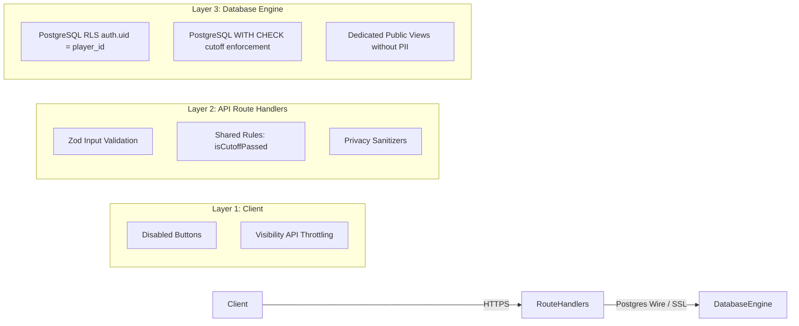

# PINT FC — Threat Model & Security Controls

> **Document**: `docs/design/threats.md`  
> **Status**: Design Proposal (Pending PO Approval)

---

## 1. Overview & Threat Vectors

Because PINT FC is a grassroots club application where students and players interact with a live database, we assume a malicious or curious actor has full browser developer tools open, can inspect network requests, and can copy their authenticated JWT tokens to make direct `curl` or PostgREST requests directly to the database API.

---

## 2. Threat Analysis Matrix

| # | Threat Vector | Description / Attack Scenario | Potential Impact | Security Control & Mitigation |
| :--- | :--- | :--- | :--- | :--- |
| **T-01** | **Direct RSVP Cutoff Bypass** | A player copies their Supabase JWT and issues `PATCH /rest/v1/rsvps` or `POST /api/fixtures/[id]/rsvp` directly after the kickoff/cutoff deadline. | Compromises team attendance integrity; breaks coach's headcount. | **Postgres RLS `WITH CHECK` constraint**: The database engine rejects any insert or update where `now() >= matches.rsvp_cutoff_at`. Even with a valid JWT, the database refuses mutation. |
| **T-02** | **RSVP Impersonation & Tampering** | An authenticated player attempts to forge an RSVP on behalf of another teammate by setting `player_id = <teammate_uuid>`. | Disruption of teammates' schedules and false attendance commitments. | **Postgres RLS Ownership Enforcement**: Policy `FOR ALL USING (auth.uid() = player_id) WITH CHECK (auth.uid() = player_id)`. Players can only insert or update rows matching their own `auth.uid()`. |
| **T-03** | **Teammate Absence Reason Snooping** | A player inspects the network response payload of `/fixtures/[id]` or calls PostgREST directly to read other players' private notes (`"Working late"`, `"Injured"`). | Privacy violation and peer embarrassment. | **Column-Level Privilege / Masking View**: `rsvps.note` is never returned in public or teammate lists. The API explicitly strips notes for `player_id != auth.uid()`, and the database view `view_teammate_rsvps` omits the `note` column entirely. |
| **T-04** | **Public PII Harvesting (Invariant 1 Breach)** | An unauthenticated scraper queries `/api/players`, `/squad`, or PostgREST directly attempting to extract emails, phone numbers, or dates of birth. | Breach of player privacy and GDPR compliance violation. | **Database View Isolation**: Raw `players` table `SELECT` permission is revoked from the `anon` role. Public traffic can only query `view_public_players`, which physically lacks `email`, `phone`, `date_of_birth`, and `guardian_*` columns. |
| **T-05** | **Under-18 Minor Exposure** | A visitor navigates to the profile of a player under 18 whose guardian has not opted in for public display. | Child safeguarding violation. | **Automated Minor Filter**: Database view `view_public_players` automatically excludes players where `is_under_18 = true` unless both `guardian_consent = true` AND `opt_in = true`. The API layer also asserts this rule. |
| **T-06** | **Unpublished Match Leakage** | A user queries the matches endpoint to see scores of unpublished draft matches or scout future unannounced games. | Premature score release; distorted season record totals. | **RLS Match Filtering**: Policy `FOR SELECT USING (published = true OR status = 'scheduled')`. Results marked `published = false` return zero rows to public queries. |
| **T-07** | **Archived Player Resurfacing** | An ex-player who requested removal or was archived appears in team lists or search engines. | Violation of club policy and privacy expectations. | **Filter Invariant**: `archived = false` is hardcoded into `view_public_players` and enforced in all API queries. Direct profile queries for archived IDs return `404 Not Found`. |
| **T-08** | **Session Hijacking Across Devices** | A player logs in on a shared computer and leaves without closing the browser, or their session token is compromised. | Unauthorized attendance tampering. | **Global Sign-Out (`AC-1.6.2`)**: The player can trigger "Sign out of all devices" from any other device, instructing Supabase GoTrue to invalidate all active refresh tokens for that `auth.uid()`. |
| **T-09** | **Live Polling Denial of Service (DoS)** | Multiple classroom projectors or tabs left running indefinitely flood Vercel serverless functions and Supabase connection limits. | Service degradation and potential free-tier quota exhaustion. | **Visibility API + Polling Rate Limiting**: The polling hook automatically detaches when `document.visibilityState === 'hidden'`. The `/counts` endpoint is lightweight and served with HTTP caching headers. |
| **T-10** | **Preview Cookie Domain Leakage** | Cookies created during Vercel PR preview testing leak into production or other preview branches. | Session confusion across test runs. | **Host-Only Cookies**: Cookies are set without a `Domain` attribute, scoping them strictly to the specific `subdomain.vercel.app` host. |

---

## 3. Defense-in-Depth Summary

Every authorization and privacy guarantee is anchored in **Layer 3 (Database Engine)**, ensuring that even if Layer 1 or Layer 2 are bypassed, the system remains impregnable.
